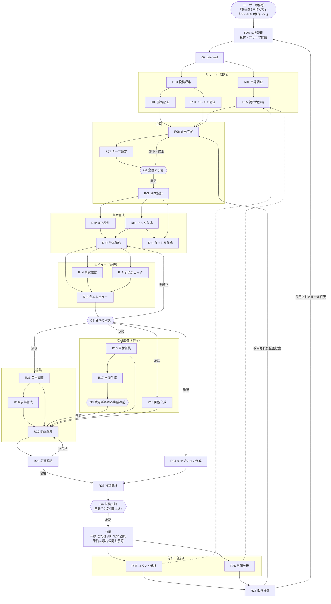

# 制作の流れ（ワークフロー）

状態: 下書き（ユーザー回答待ち）

リサーチ → 企画 → 台本作成 → レビュー → 素材準備 → 編集 → 品質確認 →（投稿）→ 分析 → 改善提案 → 次の企画へ

全体の進行・承認依頼・差し戻しの振り分けは R28 進行管理が行います。承認ゲート（G1〜G4）では、ユーザーの回答があるまで次の工程に進みません。

## フローチャート

## 工程ごとの担当・並行作業・成果物

成果物は動画ごとのフォルダ `videos/<YYYYMMDD>_<slug>/` に置きます（以下、このフォルダからの相対パス）。

| # | 工程 | 担当（並行可は「／」） | 主な成果物 | 次へ進む条件 |
|---|---|---|---|---|
| 0 | 受付 | R28 | `00_brief.md`, `progress.md`, `cost_ledger.csv` | ユーザーがブリーフを確認 |
| 1 | リサーチ | R01／R03→(R02／R04)／R05（R01の後） | `01_research/market.md`, `posts.csv`, `collection_log.md`, `competitors.md`, `trends.md`, `audience.md` | 5ファイルが完了条件を満たす |
| 2 | 企画 | R06 → R07 → **G1** → R08 | `02_plan/ideas.md`, `theme_decision.md`, `structure.md` | G1承認、構成の合計秒数が尺以内 |
| 3 | 台本作成 | R12／R09 → R10・R11 | `03_script/cta.md`, `hooks.md`, `script.md`, `title.md` | 台本v1完成 |
| 4 | レビュー | R14／R15 → R13 → **G2** | `04_review/fact_check.md`, `expression_check.md`, `script_review.md`, `03_script/script_approved.md` | G2承認 |
| 5 | 素材準備 | R16 → R17（**G3**）／R18／R24（説明文の下書き） | `05_assets/assets_list.csv`, `generation_requests.md`, `generated/`, `thumbnails/`, `diagrams/`, `diagrams.md`, `08_publish/description.md` | 全シーンに素材、承認待ちなし |
| 6 | 編集 | R21 → R19 → R20 | `06_edit/audio/*`, `subtitles_*.srt`, `subtitle_notes.md`, `long_draft.mp4`, `shorts/*_draft.mp4`, `edit_log.md` | draft書き出し |
| 7 | 品質確認 | R22 | `07_qc/qc_report.md`, `06_edit/*_final.mp4` | 総合判定「合格」 |
| 8 | 投稿 | R24 → R23 → **G4** | `08_publish/upload_settings.md`, `description.md`, `publish_log.md` | G4承認後、公開。URL記録 |
| 9 | 分析 | R25／R26 | `09_analysis/comments.md`, `metrics.csv`, `metrics_report.md` | 記録タイミング（【未確定：ユーザー回答待ち】）ごとに記録 |
| 10 | 改善提案 | R27 → R28 | `10_improve/proposals.md`（週次は `improve/YYYY-WW_proposals.md`） | ユーザーが採否を回答 |

- 長尺＋派生Shortsの場合、Shortsは長尺と同じフォルダで作り、`06_edit/shorts/` に置きます。公開順（長尺を先にするか等）は【未確定：ユーザー回答待ち】。
- 既存パイプライン（`what-if-youtube/src/main.py plan / produce / validate`）で実行できる工程は、そのツールで行い、成果物の置き場所の対応は README の未確定事項に従います。

## 承認ゲート

| ゲート | タイミング | 担当 | ユーザーに見せるもの | 回答の記録先 |
|---|---|---|---|---|
| G1 企画の承認 | R07の推薦後、構成設計の前 | R07（依頼はR28） | 比較表、推薦案・次点案 | `02_plan/theme_decision.md`, `progress.md` |
| G2 台本の承認 | R13のレビュー後、素材準備の前 | R13（依頼はR28） | 台本、事実確認の結果、表現チェックの結果、判断が必要な箇所 | `04_review/script_review.md`, `progress.md` |
| G3 費用がかかる生成の前 | 有料の画像・動画・音声生成の **毎回の実行前** | R17・R21（依頼はR28） | 生成内容、ツール、数量、推定費用と根拠、残り予算 | `05_assets/generation_requests.md`, `cost_ledger.csv` |
| G4 投稿の前 | QC合格後、アップロード・公開の前 | R23（依頼はR28） | 完成動画、アップロード設定一式、チェックリスト、QC結果 | `08_publish/publish_log.md`, `progress.md` |

- **公開は自動では行いません。** 初期値は手動（ユーザーがYouTube Studioで行う）。
- YouTube Data API の設定（Google Cloud プロジェクト、OAuth 同意画面）をユーザーが行い、利用を承認した後は、R23が「非公開」または「予約公開」でアップロードできます。この場合も **アップロード前（G4）** と **最終の公開前** の両方でユーザー承認を取ります。
- 未確認の API プロジェクトからのアップロードが非公開に制限される可能性があるとされています（未確認）。利用開始前に公式ドキュメントで確認し、`rules/approval.md` に結果を書きます。
- 上記以外にも、`rules/approval.md` の作業（外部への送信、他者の著作物の使用、事実主張の公開など）は実行前に確認します。

## チェックで不合格になったとき（差し戻し先）

| チェック | 不合格の内容 | 差し戻し先 | 備考 |
|---|---|---|---|
| G1 企画の承認 | 却下 | R06（案の作り直し） | ユーザーのコメントを入力に追加 |
| G1 企画の承認 | 修正して採用 | R07（記録）→R08 | 修正内容を `theme_decision.md` に |
| R13 台本レビュー | 企画とずれている | R10（大きい場合はR07→G1再承認） | |
| R13 台本レビュー | 構成・尺 | R10、構成自体の問題はR08 | |
| R13 台本レビュー | CTA | R12 | |
| R14 事実確認 | 確認できない／誤り | R10（修正案つき） | 削る・弱める・置き換えるをユーザー判断に回すこともある |
| R15 表現チェック | NG一致・注意領域 | R10（タイトル・サムネ文字はR11、フックはR09） | |
| G2 台本の承認 | 要修正 | R13が差し戻し先を判断（R10/R09/R11/R12） | |
| G3 費用の承認 | 却下・減額 | R17/R21（無料の手段への置換、またはR16・R18への振替） | |
| R22 品質確認 | 台本と不一致・尺・配置 | R20 | |
| R22 品質確認 | 字幕 | R19 | |
| R22 品質確認 | 音声・ラウドネス・読み間違い | R21 | |
| R22 品質確認 | 素材の権利・クレジット | R16 | |
| R22 品質確認 | 生成物の破綻・人物類似 | R17（追加費用はG3） | |
| R22 品質確認 | 図解の数値 | R18（数値自体の誤りはR14） | |
| R22 品質確認 | 台本にない事実主張 | R14 → R13 | |
| G4 投稿の前 | タイトル・サムネ文字 | R11（合成し直しはR17） | |
| G4 投稿の前 | 説明文・タグ | R24 | |
| G4 投稿の前 | 動画の中身 | R22が差し戻し先を判断 | |

- 同じ箇所で2回以上差し戻しになったら、R28がユーザーに相談します。
- 差し戻しはすべて `progress.md` の差し戻し記録に書き、R27の改善提案の材料にします。

## 改善のループ

1. 公開後、R25・R26が記録タイミングごとに分析（【未確定：ユーザー回答待ち】）。週次のまとめは `skills/weekly-analytics-review.md`。
2. R27が企画・工程・ルールの改善案を出し、R28がユーザーに採否を確認。
3. 採用された企画提案は次回のR06の入力に、ルール変更は `skills/rule-update.md` で `rules/` に反映。
